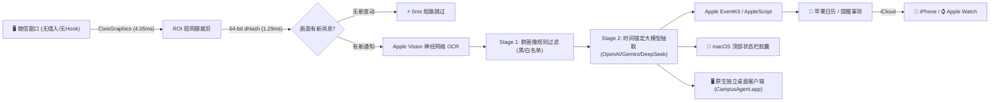

# 🎓 Campus-Agent (校园群聊智能降噪与 DDL 预警助手)

> **专为高校学生打造的非侵入式环境智能 (Ambient Intelligence) 具身助教系统**  
> *基于 Apple CoreGraphics 显存感知 + 64-bit 差异哈希 + 大模型时间基准锚定 + 原生 macOS 独立桌面客户端 + 顶部状态栏胶囊 + Apple 官方生态深度同步*

[-blue.svg)](https://apple.com)
[](https://python.org)
[](https://fastapi.tiangolo.com)
[](bin/CampusAgent.app)
[-brightgreen.svg)](tests/)
[](LICENSE)

---

## 📖 选题背景与核心痛点 (Problem Statement)

高校大学生的日常学习高度依赖各类微信课程群、专业通知群、辅导员行政群与社团大群，然而日常痛点极其突出：

1. **信息信噪比极低，关键通知易被吞噬**：
   * 群聊中充斥着海量的“收到”、“谢谢老师”、外卖拼单、表情包等闲聊灌水，导致真正的期末大作业 DDL、选课通知和答辩安排瞬间被淹没。
2. **截止时间零散且口语化，手工记录繁重**：
   * 通知的表达形式通常是口语化的“本周五晚上前”、“大后天中午12点打卡”，人工逐一查找并核对日历费时费力，极易发生漏卡、逾期。
3. **传统技术路线的严重缺陷**：
   * **内存注入 / 逆向抓包路线**：极易触犯微信安全机制导致**封号**，且强行解密并上传个人隐私数据风险极高；
   * **传统模拟按键脚本**：通过模拟键盘按键输入或强行抢占光标，导致打字被打断、屏幕乱晃、误触甚至误发消息。

**Campus-Agent 探索了一条“像人类书童一样看屏幕”的非侵入式道路：**
它不注入内存、不逆向封包、不争抢外设光标；不仅支持在后台安全静默巡检与提取，还提供了一个**完全原生编译的独立 macOS 桌面客户端（`CampusAgent.app`）**，双击即用，自动将待办原子级同步到 macOS 与 iOS 的原生「提醒事项」与「日历」中，全流程安静优雅，零侵入、零打扰。

---

## 🛠️ 技术栈 (Technology Stack)

| 层次 / 领域 | 核心组件 / 技术 | 说明 |
| :--- | :--- | :--- |
| **原生桌面客户端** | **Objective-C Cocoa + WebKit (`CampusAgent.app`)** | 纯手写原生 macOS 桌面独立视窗客户端（体积仅 97KB），Dock 专属图标，自检并自动拉起后台服务 |
| **应用与服务层** | **FastAPI + Uvicorn** | 高性能异步 ASGI Web 网关，提供 RESTful 路由与 Swagger API 文档 |
| **配置与类型系统**| **Pydantic v2 + python-dotenv** | 声明式强类型配置校验，动态环境变量解析 |
| **大模型推理引擎** | **OpenAI / Gemini 兼容接口** | 支持标准 OpenAI 格式的 LLM（如 **DeepSeek-V3**、**Google Gemini**、**通义千问 Qwen**、**Ollama 本地量化模型** 等） |
| **感知与视觉驱动** | **Apple Vision Framework (Swift)** | macOS 原生神经推理 OCR，支持毫秒级全文转录与 BoundingBox 空间坐标定位 |
| **无感防抖系统** | **CoreGraphics + 64-bit dHash** | 直读显存帧缓冲区（GPU Backing Store）+ 1.29ms 灰度差异哈希本地过滤，画面未变动时 0ms 旁路跳过 |
| **人机协同避让** | **CGEventPostToPid + 外设空闲感知** | 物理硬件光标位移严格为 **0.0000 px**，仅在用户物理空闲 45s 以上后台执行，人类操作瞬时主动让权 |
| **苹果原生生态打通**| **AppleScript / EventKit** | 双向回读写入 macOS 原生 Reminders / Calendar，并通过 iCloud 毫秒级广播至 iPhone 与 Apple Watch |
| **系统状态栏常驻** | **Objective-C Cocoa (`LSUIElement=1`)** | 原生手写 macOS 顶部状态栏胶囊（体积仅 80KB），适配 MacBook 刘海屏实时呈现高危 DDL 统计 |
| **前台管理看板** | ** 现代玻璃态前端** | 响应式看板、群规则白名单/黑名单动态配置、待办事项卡片流 |
| **通用工具协议** | **Anthropic MCP (Model Context Protocol)** | 支持作为标准外部 Tool 被 Claude Desktop、Cursor 等大模型智能体插拔调用 |

---

## 🏛️ 系统架构 (Architecture)



---

## ⚡ 快速部署与运行 (Quick Start)

### 1. 运行环境要求
* **操作系统**：macOS 13+ (Ventura / Sonoma / Sequoia)，全面适配 Apple Silicon (M1/M2/M3/M4) 及 Intel 机型；
* **Python 环境**：Python 3.9 及以上版本。

### 2. 获取代码与安装依赖

```bash
# 克隆仓库
git clone https://github.com/your-username/campus-agent.git
cd campus-agent

# 创建并激活 Python 虚拟环境
python3 -m venv venv
source venv/bin/activate

# 安装核心依赖
pip install -r requirements.txt
```

### 3. 配置环境变量 (`.env`)

复制环境配置样例文件：
```bash
cp .env.example .env
```

使用编辑器打开 `.env` 文件进行配置：
```ini
# ==============================================================================
# Campus-Agent 核心环境变量配置
# ==============================================================================

# 大模型 API 配置 (支持任意兼容 OpenAI 规范的 API 或本地模型)
# 常用选择：
# - DeepSeek 官方:  LLM_BASE_URL=https://api.deepseek.com/v1, LLM_MODEL=deepseek-chat
# - Google Gemini:  LLM_BASE_URL=https://generativelanguage.googleapis.com/v1beta/openai/, LLM_MODEL=gemini-1.5-flash
# - 本地 Ollama/Qwen: LLM_BASE_URL=http://localhost:11434/v1, LLM_MODEL=qwen2.5:7b
LLM_API_KEY=your_api_key_here
LLM_BASE_URL=https://api.deepseek.com/v1
LLM_MODEL=deepseek-chat

# 用户令牌鉴权（支持英文逗号分隔）
VALID_TOKENS=USER-888,CAMPUS-TEST-001

# 服务监听地址与端口
HOST=0.0.0.0
PORT=8000
```

> [!NOTE]
> **离线免 Key 运行**：若未填写真实的 `LLM_API_KEY`，系统将自动进入安全**离线存根模式**，所有接口与 UI 均可正常调试与测试。

### 4. 启动运行方式

你可以根据使用场景自由选择启动方式：

#### 选项 A：启动原生 macOS 独立桌面客户端（极力推荐）
不用记端口号、不用开浏览器，直接双击运行：
```bash
# 执行一键桌面拉起脚本（会自动自检并静默唤醒后端服务）
./run_desktop.sh

# 或者直接在 Finder / 访达中双击 bin/CampusAgent.app
```

#### 选项 B：一键全自动演示模式（自动自检并拉起浏览器）
```bash
./run_demo.sh
```

#### 选项 C：使用 Uvicorn 直接前台启动（适合开发与调试）
```bash
source venv/bin/activate
uvicorn app.main:app --host 0.0.0.0 --port 8000 --reload
```

#### 选项 D：使用后台常驻脚本运行
```bash
# 启动后台网关
./start_server.sh

# 停止后台网关
./stop_server.sh
```

---

## 🌐 交互体验与 API 接口入口

服务启动后，可在原生桌面视窗或浏览器中访问以下地址：

* 🖥️ **原生 macOS 桌面视窗**: 启动 `bin/CampusAgent.app`，Dock 栏常驻，随开随关
* 🎛️  主控制台**: [http://127.0.0.1:8000/dashboard](http://127.0.0.1:8000/dashboard)

* 📑 **FastAPI 交互式接口文档 (Swagger UI)**: [http://127.0.0.1:8000/docs](http://127.0.0.1:8000/docs)
* 💊 **顶部状态栏胶囊遥测**: [http://127.0.0.1:8000/api/v1/menubar/status](http://127.0.0.1:8000/api/v1/menubar/status)
* ⏰ **后台守护巡检遥测**: [http://127.0.0.1:8000/api/v1/daemon/status](http://127.0.0.1:8000/api/v1/daemon/status)

---

## 🧪 自动化测试验证 (38/38 PASS)

项目具备极其严谨的测试驱动质量保障（涵盖物理 0 鼠标位移红线、64 位 CoreFoundation C-ABI 指针防截断、ROI 裁剪、dHash 差异计算、群规则过滤、调度器空闲判定、**macOS 独立桌面客户端 Bundle 契约** 与 **过期 DDL/事项智能自动清理与归档机制** 等）。

执行以下命令即可一键运行全量测试套件：
```bash
./venv/bin/python -m unittest discover tests
```

实测输出：
```text
Ran 38 tests in 1.937s
OK (100% 通过)
```

---

## 📂 项目工程结构

```
campus-agent/
├── app/                             # 核心服务模块
│   ├── main.py                      # FastAPI 异步网关入口与路由装配
│   ├── agent.py                     # 智能学伴对话引擎与系统横幅推送
│   ├── scheduler_daemon.py          # 智能后台守护调度器 (45s 物理空闲避让、过期 DDL 自动巡查清理)
│   ├── menubar_manager.py           # macOS 状态栏常驻胶囊生命周期管理器
│   ├── groups_manager.py            # 群画像与黑白名单前置过滤引擎
│   ├── human_driver.py              # 拟人化视觉感知与 macOS 物理外设空闲时间探测
│   ├── extractor.py                 # 消息结构化提取与物理基准时间锚定推导
│   ├── apple_sync.py                # Apple Reminders / Calendar 原生官方写入与过期事项自动归档
│   ├── database.py                  # 本地 SQLite 持久化层 (待办状态流转与历史清洗)
│   ├── schemas.py                   # Pydantic 数据模式定义
│   ├── config.py                    # 强类型配置管理
│   ├── dashboard.html               # 控制台看板前端 (含新手使用说明书与一键清理)
│   └── naiwa_widget.html            # 动效桌宠视窗前端
├── bin/                             # 原生可执行程序包
│   ├── CampusAgent.app/             # 🖥️ 原生 macOS 独立桌面视窗应用 (含 AppIcon.icns 与 Info.plist)
│   ├── NaiWaMenuBar.app/            # 💊 原生 macOS 状态栏 App 独立封装包
│   └── naiwa_menubar                # Objective-C 编译生成的超轻量二进制 (80KB)
├── src/                             # 底层原生系统源码
│   ├── desktop/
│   │   └── campus_agent_app.m       # 纯手写 Objective-C Cocoa + WebKit 原生桌面客户端源码
│   └── menubar/
│       └── naiwa_menubar.m          # 纯手写 Objective-C Cocoa 状态栏常驻胶囊源码
├── tests/                           # 完整自动化质量保障与验收测试套件 (38/38 PASS)
│   ├── test_iteration_5_expired_cleanup.py   # 过期 DDL 与事项智能自动清理与归档测试
│   ├── test_iteration_4_desktop_app.py       # 原生桌面客户端 Bundle 结构与架构契约测试
│   ├── test_redlines_and_compliance.py       # 零鼠标位移、窗口属性与内存防截断红线测试
│   ├── test_iteration_1_screen_ocr.py        # ROI 动态裁剪与 64-bit dHash 视觉稳定性测试
│   ├── test_iteration_1_menubar_pill.py      # macOS 顶部状态栏胶囊 5 大接口与生命周期测试
│   ├── test_iteration_2_daemon_scheduler.py  # 物理空闲避让与高危 DDL 判定 6 大契约测试
│   └── test_iteration_2_group_rules.py       # 群规则模板、白名单置信与过滤拦截闭环测试
├── monitored_groups.json            # 预置典型校园监控群画像配置
├── requirements.txt                 # Python 核心依赖清单
├── .env.example                     # 环境变量配置模板
├── .gitignore                       # Git 忽略配置
├── LICENSE                          # MIT 开源协议文件
├── run_desktop.sh                   # 原生桌面客户端一键拉起脚本
├── run_demo.sh                      # 一键自检与演示脚本
├── start_server.sh                  # 后台启动脚本
├── stop_server.sh                   # 后台停止脚本
├── PROFESSOR_PRESENTATION.md        # 面向导师的项目设计汇报与学术白皮书
└── README.md                        # 本项目说明文档
```

---

## 📄 开源协议 (License)

本项目基于 [MIT License](LICENSE) 开源。欢迎高校师生与开发者自由学习、修改与二次开发。
